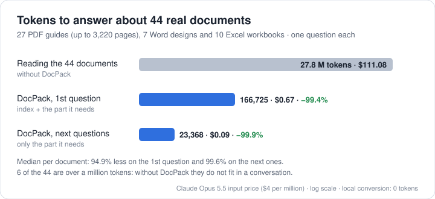
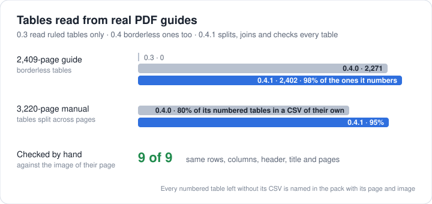
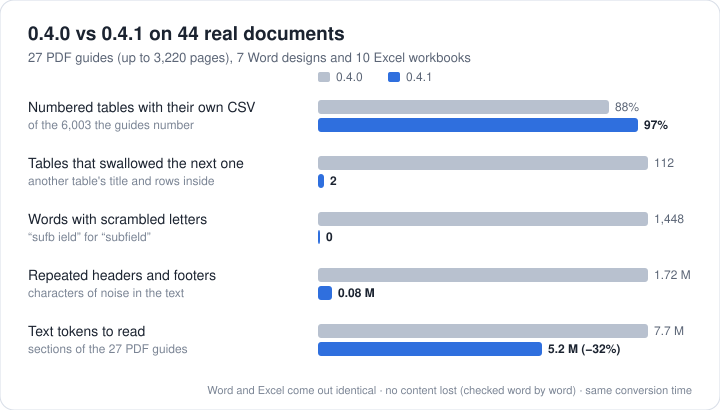

# DocPack benchmarks

**English** · the same numbers in Spanish are in [README.es.md](README.es.md#métricas).

## The corpus

44 real working documents: 27 PDF technical guides (2 to 3,220 pages), 7 Word
designs and 10 Excel workbooks. They are private documents and cannot be
published, so their names are not given. Every behavior measured here is also
covered by the public [`examples/`](examples/) and the tests in
`engine/tests/`, which anyone can run:

```bash
cargo test --release --manifest-path engine/Cargo.toml
```

## Tokens

For each document:

- **Without DocPack** is reading it whole: all its text and tables. That is the
  minimum; reading an original PDF also adds the image of every page.
- **With DocPack, the first question** is its index plus the part it needs (the
  median of its parts, short sections and tables).
- **Each next question** reads only that part: the index is already read.

Tokens are the estimate each pack carries (within 1.4% of what was measured on
a Word design); dollars are at Claude Opus 5.5's input price, $4 per million.

<p align="center"></p>

| 44 documents | Without DocPack | With DocPack | Savings |
|---|---:|---:|---:|
| First question on each document | 27.8 M tokens · $111.08 | 166,725 · $0.67 | **99.4%** |
| Each next question | 27.8 M · $111.08 | 23,368 · $0.09 | **99.9%** |
| Ten questions on each document | 277.7 M · $1,110.84 | 377,037 · $1.51 | **99.9%** |
| Median per document (1st question · next) | | | **94.9% · 99.6%** |
| Documents too big for one conversation (over a million tokens) | 6 | 0 | |

| By type | Documents | Read whole | 1st question | Savings | Next | Savings |
|---|---:|---:|---:|---:|---:|---:|
| PDF | 27 | 11.1 M | 119,576 | 98.9% | 17,467 | 99.8% |
| Word | 7 | 311,400 | 29,149 | 90.6% | 2,144 | 99.3% |
| Excel | 10 | 16.3 M | 18,000 | 99.9% | 3,757 | 99.98% |

The ten questions assume that without DocPack the document is read again for
each one; if it stays in the context it is not read again, but it takes those
tokens for the whole conversation. Savings are smaller on small documents: on a
two-page one, the index weighs half the document.

These numbers were measured with version 0.4.1. Version 0.4.7 also removes the
padding of fixed-width Excel exports: on a real 10-sheet export its CSV went
from 2.18 MB to 231 KB (−89%), so Excel only gets better.

## Speed

| | Result |
|---|---:|
| Converting an 88,000-token Word design | 0.14 to 0.3 s |
| Six test documents (Word, Excel, PDF) | 139 to 295 ms each |
| Paginating a 108-page Word document with Word, with its page images | 20 to 30 s, only the first time |
| OCR of a scanned page | ~0.5 s |
| Opening an unchanged document again | instant: the pack is reused by its SHA-256 |
| Tokens spent converting | **0**, everything happens on your machine |

## Fidelity

| What was checked | Result |
|---|---:|
| Table cells present in the pack | **6,393 of 6,393** |
| Symbols inserted with Word's "Insert symbol" (arrows →) | **71 of 71** |
| Error of the index's token estimate | **−1.4%** (86,904 estimated, ~88,120 measured) |
| Index size after optimizing it | 19,105 → 7,829 characters (**−59%**) |
| Image repeated in a document | stored once, referenced twice |
| Word pages (paginated by Word) | **33 of 33** sections on their right page |
| Tables of the same design exported to PDF | **6,258 of 6,323** cells equal to the Word's (99%) |
| Scanned page (image only, no text) | full text with the system's OCR |
| 2,409-page PDF guide with borderless tables | from **0** to **2,402** tables in CSV: **98%** of the ones the guide numbers |
| Tables checked by hand in real PDF guides and Word designs (borderless, split over 2 and 3 pages) | **9 of 9** equal |
| Colors: text marked in red in a real technical design | **670** red pieces, the same in the Word and in its PDF |
| Colors: rows in gray (fields outside the first delivery) in another design | **382** cells, with their exact rows |
| Colors in Excel, compared with what Excel itself reports for each cell | theme colors with their tint equal (for example `FFF2CC`) |

<p align="center"></p>

## 0.4.0 vs 0.4.1 on the 44 documents

One document says little; these numbers come from converting the same 44
documents with 0.4.0 and with 0.4.1. Each metric is counted by a script over
the two packs, and the content was compared word by word.

<p align="center"></p>

| | 0.4.0 | 0.4.1 |
|---|---:|---:|
| Tables the guides number ("Table 16:") with a CSV of their own | 5,286 of 6,003 (88%) | **5,826 of 6,003 (97%)** |
| Tables that kept the title and rows of the next one | 112 | **2** |
| Words with scrambled letters ("sufb ield" for "subfield") | 1,448 | **0** |
| Characters of repeated headers and footers in the text | 1,718,779 | **75,372** (−96%) |
| Text tokens of the 27 PDF guides | 7.7 million | **5.2 million** (−32%) |
| PDF bookmark subheadings inside the sections | 0 | **4,557** |
| Rotated pages read letter by letter (one-letter lines, in one guide) | 191,694 | **3,994** |
| Numbered tables without their own CSV that the pack names with their page | none | **all** |
| Word and Excel | | identical |
| Conversion time for the 44 | 249 s | 255 s |

Fewer tokens is not less content: what went is what repeated on every page
(the copyright notice, the guide's name, the page number) and text that used to
come out broken. Whatever was read before is still read.

## The package

| | |
|---|---:|
| Binary | ~3 MB, no dependencies |
| Needs internet | no |
| Needs Python or Node | no |
| Needs Office | no; with Word or LibreOffice, Word documents get page numbers |
