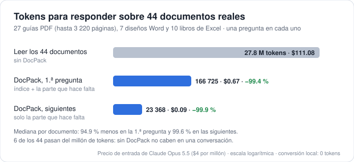
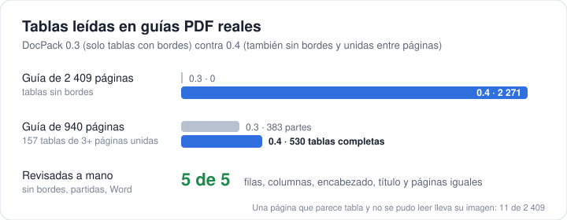
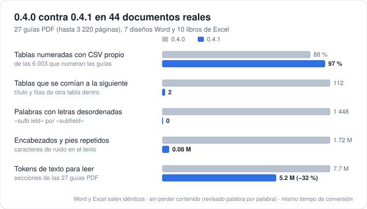

# DocPack

Cuando le pasas a Claude un PDF o un Word grande, lo lee completo aunque solo
quieras saber una cosa de la página 40. Eso cuesta tokens, llena el contexto y,
si el documento es muy largo, ni siquiera cabe en una sola lectura.

DocPack lo resuelve de una forma sencilla: convierte el documento **en tu
computadora** en una carpeta ordenada por partes. Claude abre primero un índice
pequeño, ve qué secciones y tablas hay y cuánto pesa cada una, y lee solo lo
que necesita para responder.

Lo hice para mi propio trabajo con diseños técnicos largos y lo comparto tal
como lo uso. Viene integrado en [Sky Agent](https://ia.skyoflies.com) y
funciona como plugin de Claude Code. Más en
[ia.skyoflies.com/docpack.html](https://ia.skyoflies.com/docpack.html).

— Juan Antonio Sandoval Puente · [skyoflies.com](https://skyoflies.com)

<p align="center"></p>

## Métricas

Las medí con un diseño técnico real en Word: 89 tablas, 6 393 celdas, 13
imágenes y unos 88 000 tokens si se lee entero. Primero lo leí completo, sin
nada instalado, y después a través de DocPack, y comparé las dos lecturas.

### Tokens

| | Sin DocPack | Con DocPack | Ahorro |
|---|---:|---:|---:|
| Primera pregunta (índice + la sección que hacía falta) | ~88 120 | ~12 800 | **85 %** |
| Cada pregunta siguiente | ~88 120 | ~3 400 | **96 %** |
| Diez preguntas sobre el mismo documento | ~881 000 | ~43 400 | **95 %** |
| Lecturas necesarias para ver el documento | 4 o más (cada lectura admite unos 25 000) | 1 o 2 | |

Las diez preguntas suponen que sin DocPack el documento se vuelve a leer en
cada una. Si sigue en el contexto no se relee, pero entonces ocupa esos 88 000
tokens en toda la conversación.

### Velocidad

| | Resultado |
|---|---:|
| Convertir el diseño de 88 000 tokens | 0.14 a 0.3 s |
| Seis documentos de prueba (Word, Excel, PDF) | 139 a 295 ms cada uno |
| Paginar un Word de 108 páginas con Word, con sus imágenes de página | 20 a 30 s, solo la primera vez |
| OCR de una página escaneada | ~0.5 s |
| Volver a abrir un documento sin cambios | instantáneo: se reusa el pack por su huella SHA-256 |
| Tokens gastados al convertir | **0**, todo pasa en tu máquina |

### Fidelidad

| Qué se revisó | Resultado |
|---|---:|
| Celdas de tablas presentes en el pack | **6 393 de 6 393** |
| Símbolos insertados con «Insertar símbolo» de Word (flechas →) | **71 de 71** |
| Error de la estimación de tokens del índice | **−1.4 %** (86 904 estimados, ~88 120 medidos) |
| Peso del índice tras optimizarlo | 19 105 → 7 829 caracteres (**−59 %**) |
| Imagen repetida en el documento | se guarda una vez y se referencia dos |
| Páginas del Word (paginado por Word) | **33 de 33** secciones en su página correcta |
| Tablas del mismo diseño exportado a PDF | **6 258 de 6 323** celdas iguales a las del Word (99 %) |
| Página escaneada (solo imagen, sin texto) | texto completo con el OCR del sistema |
| Guía técnica en PDF de 2 409 páginas con tablas sin bordes | de **0** a **2 402** tablas en CSV: el **98 %** de las que la guía numera |
| Tablas revisadas a mano en guías PDF y diseños Word reales (sin bordes, partidas en 2 y 3 páginas) | **9 de 9** iguales |

<p align="center"></p>

### En 44 documentos reales (0.4.1)

Un documento dice poco; estas cifras salen de convertir con la 0.4.0 y con la
0.4.1 los mismos 44 documentos de trabajo: 27 guías técnicas en PDF (de 2 a
3 220 páginas), 7 diseños en Word y 10 libros de Excel. Cada métrica la cuenta
un script sobre los dos packs, y el contenido se comparó palabra por palabra.

<p align="center"></p>

| | 0.4.0 | 0.4.1 |
|---|---:|---:|
| Tablas que las guías numeran («Table 16:») con su CSV propio | 5 286 de 6 003 (88 %) | **5 826 de 6 003 (97 %)** |
| Tablas que se quedaban con el título y las filas de la siguiente | 112 | **2** |
| Palabras con letras desordenadas («sufb ield» por «subfield») | 1 448 | **0** |
| Caracteres de encabezados y pies repetidos en el texto | 1 718 779 | **75 372** (−96 %) |
| Tokens de texto de las 27 guías PDF | 7.7 millones | **5.2 millones** (−32 %) |
| Subtítulos de los marcadores del PDF dentro de las secciones | 0 | **4 557** |
| Páginas apaisadas leídas letra por letra (líneas de una sola letra, en una guía) | 191 694 | **3 994** |
| Tablas numeradas sin CSV propio que el pack nombra con su página | ninguna | **todas** |
| Word y Excel | | idénticos |
| Tiempo de conversión de los 44 | 249 s | 255 s |

Menos tokens no es menos contenido: lo que salió es lo que se repetía en cada
página (el aviso de copyright, el nombre de la guía, el número de página) y el
texto que antes salía roto. Lo que sí se leía antes se sigue leyendo.

### El paquete

| | |
|---|---:|
| Ejecutable | ~3 MB, sin dependencias |
| Necesita internet | no |
| Necesita Python o Node | no |
| Necesita Office | no; si hay Word o LibreOffice, los Word salen con número de página |

Los números cambian con cada documento, pero la idea se mantiene: **pagas por
lo que lees, no por el documento entero.**

## Instalación (Claude Code)

Dentro de Claude Code:

```
/plugin marketplace add xskyofx-lang/docpack
/plugin install docpack@docpack
/reload-plugins
```

O desde la terminal:

```bash
claude plugin marketplace add xskyofx-lang/docpack
```

```bash
claude plugin install docpack@docpack
```

Eso es todo. No hay que instalar Python, ni Rust, ni nada más: el plugin trae
el ejecutable de DocPack ya compilado.

**Sistemas:** Windows (x64), Linux (x64 y ARM64) y macOS (Apple Silicon e
Intel). El plugin trae el ejecutable de cada uno y elige solo el que toca.

Algunas funciones usan lo que tu sistema ya trae. Si falta algo, el pack se
crea igual y `manifest.json` dice qué no se pudo hacer y por qué:

| Función | Windows | macOS | Linux |
|---|---|---|---|
| Imágenes de página | incluido en Windows | incluido en macOS | `pdftoppm` (paquete `poppler-utils`) |
| OCR de páginas escaneadas | OCR de Windows, en los idiomas de tu perfil | Vision de macOS, en tus idiomas | `tesseract` con sus idiomas (por ejemplo `tesseract-ocr-spa`) |
| Números de página en Word | Microsoft Word o LibreOffice | LibreOffice | LibreOffice |

## Cómo usarlo sin gastar tokens de más

En la práctica no tienes que hacer nada especial: pídele a Claude lo que
necesites del documento y él se encarga. Aun así hay cosas que marcan la
diferencia.

**Dale la ruta, no el adjunto.** Si arrastras el PDF al chat, el archivo le
llega entero a Claude antes de que cualquier plugin pueda hacer algo. Mejor
déjalo en la carpeta del proyecto y menciónalo:

> «En `docs/diseno.docx`, ¿qué validaciones tiene el campo de fecha?»

**Pregunta por algo concreto.** «¿Qué dice la sección de errores?» hace que lea
una sección. «Resúmeme todo el documento» lo obliga a leerlo todo, con o sin
DocPack.

**Sigue en la misma conversación.** La primera pregunta paga el índice; las
siguientes ya lo tienen y solo leen la parte nueva.

**El original, solo si de verdad lo necesitas.** Claude no abre el documento
original a menos que tú se lo pidas, de forma explícita y con páginas:

> «Mira la página 12 del PDF original, quiero ver el diagrama.»

Eso sí lo deja pasar, y solo esas páginas.

**Si cambias el documento, no hagas nada.** DocPack se da cuenta por la huella
del archivo y vuelve a convertirlo la siguiente vez que Claude lo lea.

## Cómo funciona por dentro

Todo pasa en tu máquina. DocPack no se conecta a internet, no manda el
documento a ningún lado y no usa servicios externos: lee la estructura que el
propio archivo ya trae y, cuando hace falta, usa los motores que tu sistema
tiene instalados (OCR, Word o LibreOffice para paginar).

1. Claude intenta leer `diseno.docx`.
2. Antes de que esa lectura ocurra, el plugin (un *hook* de Claude Code)
   ejecuta DocPack. Si ya hay un pack de ese archivo y su huella coincide, lo
   reusa; si no, lo crea.
3. En lugar del documento, Claude recibe un aviso corto: «este documento está
   en `docpack/diseno.docx/`, empieza por `index.json`».
4. Claude abre el índice y después solo las secciones o tablas que necesita.

El documento original nunca se modifica. El pack queda junto a tu proyecto:

```
tu-proyecto/
  diseno.docx
  docpack/
    index.json        catálogo: cada pack con título, versión y fecha del documento
    diseno.docx/
      manifest.json   de dónde salió, huella SHA-256, título/versión/fecha, avisos
      index.json      secciones, líneas y tokens estimados → se lee primero
      secciones/      01-objetivo.md, 02-alcance.md …
      tablas/         T01.csv … e index.json (título, encabezado y páginas de cada tabla)
      figuras/        F01.png …  (imágenes del Word) e index.json
      paginas/        p001.png … (cada página como imagen, o solo las que hay que revisar)
```

Cómo se parte cada formato:

| Formato | Secciones | Tablas | Además |
|---|---|---|---|
| Word (DOCX) | una por cada título, según los estilos del documento | CSV | página de cada sección e imagen de cada página (con Word o LibreOffice), imágenes en `figuras/`, listas con su nivel, encabezados y pies |
| PDF | según los marcadores del PDF; si no tiene, una por página. Los marcadores más finos (un campo, un subcampo) quedan como subtítulos `###` dentro de la sección | CSV, con o sin bordes, aunque sigan en las páginas siguientes | OCR en las páginas escaneadas, imagen de cada página, índice de contenido marcado, páginas apaisadas enderezadas, sin el encabezado y el pie que se repiten |
| Excel (XLSX, XLS, XLSB, ODS) | una por hoja | un CSV por hoja | las fórmulas sin valor guardado se muestran como fórmula |
| PowerPoint (PPTX) | una por diapositiva, en el orden de la presentación | CSV | número de diapositiva |

Una sección muy larga viene dividida en partes de unos 2 000 tokens con sus
números de línea, para que Claude lea solo el tramo que importa. Si la sección
tiene subtítulos, las partes empiezan en ellos y cada una dice cuál es: «PDS
0158 (Business Activity)» en lugar de una frase suelta.

Cómo se sacan las partes que el archivo no trae escritas:

- **Páginas de un Word.** Un DOCX no guarda páginas: existen solo cuando un
  programa acomoda el texto. DocPack le pide a Word (o a LibreOffice), en
  segundo plano y sobre una copia, que exporte el documento a PDF con un
  marcador por título, y cada sección toma la página de su título. Si Word ya
  estaba abierto con documentos tuyos, no lo cierra.
- **Tablas de un PDF.** Se arman con los bordes que dibuja el PDF y la
  posición de cada letra: celdas combinadas, encabezados sombreados, palabras
  que la celda partió en dos renglones y tablas abiertas por los lados. Una
  tabla **sin bordes** se lee por sus columnas: los carriles en blanco que
  bajan por todas sus líneas (un párrafo los cierra enseguida), las reglas
  entre filas si las hay, y celdas de varias líneas. Una tabla que sigue en la
  página siguiente se une en un solo CSV aunque cambie el encabezado de la
  página o repita su título. Una tabla termina donde empieza un subtítulo o el
  título de la siguiente («Table 17:»), así que nunca se queda con las filas de
  otra. Cada tabla lleva su título (el pie o la línea de encima), su encabezado
  y sus páginas. Su texto va al CSV y no se repite en la sección.
- **El propio documento revisa las tablas.** Si el documento numera sus
  tablas, DocPack cuenta cada «Table N:» contra los CSV: la que quedó como
  texto se nombra en `manifest.json` con su página, y la que lleva el título de
  otra dentro se marca con `check` en `tablas/index.json`. Esas páginas llevan
  su imagen para verlas antes de citar una celda.
- **Encabezados y pies.** Lo que se repite en el margen de cada página (el
  copyright, el nombre de la guía, el número de página) sale del texto, y la
  línea del encabezado que cambia (el tema que empieza) se queda.
- **Páginas apaisadas.** Un reporte girado dentro de una página vertical se
  endereza según hacia dónde corren sus letras, y se lee de izquierda a derecha
  con sus columnas.
- **Páginas escaneadas.** Una página que es sobre todo una imagen pasa por el
  OCR del sistema. Su texto queda marcado como OCR en la sección
  (`<!-- página 3 · texto por OCR -->`) y `manifest.json` dice qué motor lo
  leyó.

Lo que hay que tener en cuenta (y el pack lo avisa cuando aplica):

- Las tablas sin bordes se leen por la alineación de su texto: el pack dice en
  qué páginas. Si el documento numera sus tablas, el pack también nombra las
  que no quedaron en su CSV. Si una página parece tabla pero no se pudo leer como tal, queda
  como texto y su imagen va en `paginas/` aunque el pack no lleve imágenes,
  para verla antes de citar una celda.
- El OCR puede equivocarse en letras o números; para un dato crítico, pide ver
  la imagen de la página.
- Sin Word ni LibreOffice, las secciones de un Word van sin número de página y
  se citan por sección y línea.

## Usarlo sin Claude (línea de comandos)

El plugin pone el comando `docpack` en el PATH de Claude, pero también puedes
usarlo tú directamente:

```bash
docpack build diseno.pdf --project .
```

Opciones: `--force` reconstruye aunque el pack esté al día y `--no-pages` no
genera la imagen de cada página (los Word se paginan igual si hay con qué). La
salida es un JSON con la ruta del pack y sus números.

| Comando | Para qué |
|---|---|
| `docpack text diseno.pdf --pages 4-5` | El texto de esas páginas, desde el pack, sin abrir el original |
| `docpack find "ciclo de compensación"` | Buscar en todos los packs del proyecto: pack, sección o tabla, parte, página y línea |
| `docpack diff diseno_v1.3.docx diseno_v1.4.docx` | Qué cambió entre dos versiones: secciones y filas de tablas |
| `docpack doctor` | Packs a medias o desactualizados, archivos ajenos en `docpack/` y documentos sin pack |
| `docpack catalog` | Rehace `docpack/index.json` (se actualiza solo con cada pack) |

Todos aceptan `--project <carpeta>`. Un archivo `.docpackignore` en el proyecto
(un patrón por línea, por ejemplo `control_auditoria_*.xls`) deja fuera los
archivos de datos que no tiene caso convertir.

## Actualizaciones

Cada versión del plugin lleva su número en `plugin.json` (por ejemplo `0.3.0`).
Claude Code se queda con la versión que instalaste hasta que ese número cambia;
por eso, cuando corrijo algo, publico una versión nueva con otro número.

Para recibirla:

```bash
claude plugin marketplace update docpack
```

```bash
claude plugin update docpack@docpack
```

y reinicia Claude Code (o usa `/reload-plugins`). Si prefieres no pensar en
eso, activa la actualización automática en `/plugin` → **Marketplaces** →
docpack → **Enable auto-update**: Claude Code revisará por su cuenta y te
avisará cuando haya algo nuevo.

Tus packs no se quedan viejos. Cada uno guarda la versión de DocPack que lo
creó, y cuando esa versión cambia, el pack se vuelve a generar solo la próxima
vez que se lee. Lo que cambió en cada versión está en
[CHANGELOG.md](CHANGELOG.md).

## Cómo está organizado el repositorio

```
engine/                 el motor: biblioteca y comando docpack (Rust)
  src/lib.rs            convierte y arma el pack, sin saber nada de ningún agente
  src/claude_code.rs    el único archivo que conoce el protocolo de Claude Code
  vendor/pdf-extract/   pdf-extract 0.12.1 (MIT) con la lectura de anchos de
                        fuente corregida: ver engine/Cargo.toml
plugins/
  claude-code/          el plugin de Claude Code: hook, skill, bin/ (lanzador y
                        ejecutable de Windows) y native/ (Linux y macOS)
  codex/                reservado para un plugin de Codex
docs/                   formato del pack y cómo conectar otro agente
scripts/                compilar y empaquetar en local
.github/workflows/      pruebas y binarios para los tres sistemas
```

El motor no depende de Claude. Un plugin para otro agente, Codex por ejemplo,
solo necesita su propio adaptador y su carpeta en `plugins/`. Los detalles
están en [docs/integrar-otro-agente.md](docs/integrar-otro-agente.md).

## Compilar desde el código

Hace falta [Rust](https://rustup.rs) 1.80 o más nuevo.

```bash
cargo build --release --manifest-path engine/Cargo.toml
```

Para probar el plugin en tu Windows con lo que acabas de compilar (pruebas,
compilación, copia del ejecutable y verificación de que las versiones
coinciden):

```bash
powershell -ExecutionPolicy Bypass -File scripts/build-claude-plugin.ps1
```

Los ejecutables que se publican no salen de la máquina de nadie: los compila
GitHub Actions en Windows, Linux y macOS (workflow **Binarios**), comprueba que
cada uno responde con la versión del plugin y los deja en
`plugins/claude-code/` en un commit. Las pruebas corren en los tres sistemas
con cada cambio (workflow **Pruebas**).

## Licencia

MIT. Úsalo, cámbialo y compártelo; solo conserva el aviso de autoría.

Hecho por Juan Antonio Sandoval Puente · [skyoflies.com](https://skyoflies.com)
