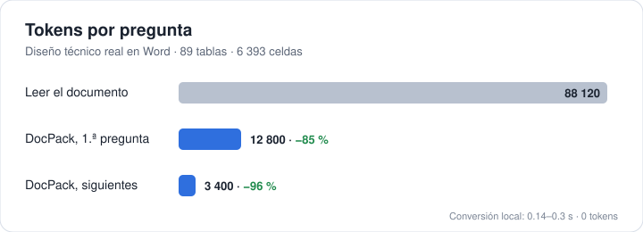

# DocPack

Cuando le pasas a Claude un PDF o un Word grande, lo lee completo aunque solo
quieras saber una cosa de la página 40. Eso cuesta tokens, llena el contexto y,
si el documento es muy largo, ni siquiera cabe en una sola lectura.

DocPack lo resuelve de una forma sencilla: convierte el documento **en tu
computadora** en una carpeta ordenada por partes. Claude abre primero un índice
pequeño, ve qué secciones y tablas hay y cuánto pesa cada una, y lee solo lo
que necesita para responder.

Lo hice para mi propio trabajo con diseños técnicos largos y lo comparto tal
como lo uso.

— Juan Antonio Sandoval Puente · [skyoflies.com](https://skyoflies.com)

<p align="center"></p>

## Métricas

Las medí con un diseño técnico real en Word: 89 tablas, 6 393 celdas, 13
imágenes y unos 88 000 tokens si se lee entero. Primero lo leí completo, sin
nada instalado, y después a través de DocPack, y comparé las dos lecturas.

### Tokens

| | Sin DocPack | Con DocPack | Ahorro |
|---|---:|---:|---:|
| Primera pregunta (índice + la sección que hacía falta) | ~88 120 | ~12 800 | **85 %** |
| Cada pregunta siguiente | ~88 120 | ~3 400 | **96 %** |
| Diez preguntas sobre el mismo documento | ~881 000 | ~43 400 | **95 %** |
| Lecturas necesarias para ver el documento | 4 o más (cada lectura admite unos 25 000) | 1 o 2 | |

Las diez preguntas suponen que sin DocPack el documento se vuelve a leer en
cada una. Si sigue en el contexto no se relee, pero entonces ocupa esos 88 000
tokens en toda la conversación.

### Velocidad

| | Resultado |
|---|---:|
| Convertir el diseño de 88 000 tokens | 0.14 a 0.3 s |
| Seis documentos de prueba (Word, Excel, PDF) | 139 a 295 ms cada uno |
| Volver a abrir un documento sin cambios | instantáneo: se reusa el pack por su huella SHA-256 |
| Tokens gastados al convertir | **0**, todo pasa en tu máquina |

### Fidelidad

| Qué se revisó | Resultado |
|---|---:|
| Celdas de tablas presentes en el pack | **6 393 de 6 393** |
| Símbolos insertados con «Insertar símbolo» de Word (flechas →) | **71 de 71** |
| Error de la estimación de tokens del índice | **−1.4 %** (86 904 estimados, ~88 120 medidos) |
| Peso del índice tras optimizarlo | 19 105 → 7 829 caracteres (**−59 %**) |
| Imagen repetida en el documento | se guarda una vez y se referencia dos |

La primera versión tenía 11 fallas contra la lectura directa: símbolos
perdidos, saltos de línea en celdas, niveles de lista, una estimación de
tokens que se quedaba a la mitad, entre otras. Están todas corregidas y con su
prueba automática; la lista está en el [CHANGELOG](CHANGELOG.md).

### El paquete

| | |
|---|---:|
| Ejecutable | ~2.8 MB, sin dependencias |
| Necesita internet | no |
| Necesita Python, Node u Office | no |

Los números cambian con cada documento, pero la idea se mantiene: **pagas por
lo que lees, no por el documento entero.**

## Instalación (Claude Code)

Dentro de Claude Code:

```
/plugin marketplace add xskyofx-lang/docpack
/plugin install docpack@docpack
/reload-plugins
```

O desde la terminal:

```bash
claude plugin marketplace add xskyofx-lang/docpack
```

```bash
claude plugin install docpack@docpack
```

Eso es todo. No hay que instalar Python, ni Rust, ni nada más: el plugin trae
el ejecutable de DocPack ya compilado.

**Sistemas:** Windows (x64), Linux (x64 y ARM64) y macOS (Apple Silicon e
Intel). El plugin trae el ejecutable de cada uno y elige solo el que toca. La
única diferencia: las imágenes de página de los PDF (`paginas/`) por ahora se
generan solo en Windows; en Linux y macOS el texto, las secciones y las tablas
salen igual, y el pack avisa en `manifest.json` que no hay imágenes.

## Cómo usarlo sin gastar tokens de más

En la práctica no tienes que hacer nada especial: pídele a Claude lo que
necesites del documento y él se encarga. Aun así hay cosas que marcan la
diferencia.

**Dale la ruta, no el adjunto.** Si arrastras el PDF al chat, el archivo le
llega entero a Claude antes de que cualquier plugin pueda hacer algo. Mejor
déjalo en la carpeta del proyecto y menciónalo:

> «En `docs/diseno.docx`, ¿qué validaciones tiene el campo de fecha?»

**Pregunta por algo concreto.** «¿Qué dice la sección de errores?» hace que lea
una sección. «Resúmeme todo el documento» lo obliga a leerlo todo, con o sin
DocPack.

**Sigue en la misma conversación.** La primera pregunta paga el índice; las
siguientes ya lo tienen y solo leen la parte nueva.

**El original, solo si de verdad lo necesitas.** Claude no abre el documento
original a menos que tú se lo pidas, de forma explícita y con páginas:

> «Mira la página 12 del PDF original, quiero ver el diagrama.»

Eso sí lo deja pasar, y solo esas páginas.

**Si cambias el documento, no hagas nada.** DocPack se da cuenta por la huella
del archivo y vuelve a convertirlo la siguiente vez que Claude lo lea.

## Cómo funciona por dentro

Todo pasa en tu máquina. DocPack no se conecta a internet, no manda el
documento a ningún lado y no usa ninguna IA para convertirlo: lee la estructura
que el propio archivo ya trae.

1. Claude intenta leer `diseno.docx`.
2. Antes de que esa lectura ocurra, el plugin (un *hook* de Claude Code)
   ejecuta DocPack. Si ya hay un pack de ese archivo y su huella coincide, lo
   reusa; si no, lo crea.
3. En lugar del documento, Claude recibe un aviso corto: «este documento está
   en `docpack/diseno.docx/`, empieza por `index.json`».
4. Claude abre el índice y después solo las secciones o tablas que necesita.

El documento original nunca se modifica. El pack queda junto a tu proyecto:

```
tu-proyecto/
  diseno.docx
  docpack/
    diseno.docx/
      manifest.json   de dónde salió, huella SHA-256, versión de DocPack, avisos
      index.json      secciones, líneas y tokens estimados → se lee primero
      secciones/      01-objetivo.md, 02-alcance.md …
      tablas/         T01.csv … e index.json
      figuras/        F01.png …  (imágenes del Word) e index.json
      paginas/        p001.png … (cada página del PDF como imagen, en Windows)
```

Cómo se parte cada formato:

| Formato | Secciones | Tablas | Además |
|---|---|---|---|
| Word (DOCX) | una por cada título, según los estilos del documento | CSV | imágenes en `figuras/`, listas con su nivel, encabezados y pies |
| PDF | según los marcadores del PDF; si no tiene, una por página | se quedan como texto | imagen de cada página (Windows) |
| Excel (XLSX, XLS, XLSB, ODS) | una por hoja | un CSV por hoja | las fórmulas sin valor guardado se muestran como fórmula |
| PowerPoint (PPTX) | una por diapositiva, en el orden de la presentación | CSV | número de diapositiva |

Una sección muy larga viene dividida en partes de unos 2 000 tokens con sus
números de línea, para que Claude lea solo el tramo que importa.

**Lo que todavía no hace** (y lo avisa en `manifest.json` cuando aplica):

- No hay OCR: un PDF escaneado aparece como «sin texto».
- Las tablas de un PDF no se detectan como tablas; quedan como texto.
- Word no guarda números de página, así que en un DOCX las referencias son por
  sección y línea, no por página.

## Usarlo sin Claude (línea de comandos)

El plugin pone el comando `docpack` en el PATH de Claude, pero también puedes
usarlo tú directamente:

```bash
docpack build diseno.pdf --project .
```

Opciones: `--force` reconstruye aunque el pack esté al día y `--no-pages` no
genera imágenes de página. La salida es un JSON con la ruta del pack y sus
números.

## Actualizaciones

Cada versión del plugin lleva su número en `plugin.json` (por ejemplo `0.2.0`).
Claude Code se queda con la versión que instalaste hasta que ese número cambia;
por eso, cuando corrijo algo, publico una versión nueva con otro número.

Para recibirla:

```bash
claude plugin marketplace update docpack
```

```bash
claude plugin update docpack@docpack
```

y reinicia Claude Code (o usa `/reload-plugins`). Si prefieres no pensar en
eso, activa la actualización automática en `/plugin` → **Marketplaces** →
docpack → **Enable auto-update**: Claude Code revisará por su cuenta y te
avisará cuando haya algo nuevo.

Tus packs no se quedan viejos. Cada uno guarda la versión de DocPack que lo
creó, y cuando esa versión cambia, el pack se vuelve a generar solo la próxima
vez que se lee. Lo que cambió en cada versión está en
[CHANGELOG.md](CHANGELOG.md).

## Cómo está organizado el repositorio

```
engine/                 el motor: biblioteca y comando docpack (Rust)
  src/lib.rs            convierte y arma el pack, sin saber nada de ningún agente
  src/claude_code.rs    el único archivo que conoce el protocolo de Claude Code
plugins/
  claude-code/          el plugin de Claude Code: hook, skill, bin/ (lanzador y
                        ejecutable de Windows) y native/ (Linux y macOS)
  codex/                reservado para un plugin de Codex
docs/                   formato del pack y cómo conectar otro agente
scripts/                compilar y empaquetar en local
.github/workflows/      pruebas y binarios para los tres sistemas
```

El motor no depende de Claude. Un plugin para otro agente, Codex por ejemplo,
solo necesita su propio adaptador y su carpeta en `plugins/`. Los detalles
están en [docs/integrar-otro-agente.md](docs/integrar-otro-agente.md).

## Compilar desde el código

Hace falta [Rust](https://rustup.rs) 1.80 o más nuevo.

```bash
cargo build --release --manifest-path engine/Cargo.toml
```

Para probar el plugin en tu Windows con lo que acabas de compilar (pruebas,
compilación, copia del ejecutable y verificación de que las versiones
coinciden):

```bash
powershell -ExecutionPolicy Bypass -File scripts/build-claude-plugin.ps1
```

Los ejecutables que se publican no salen de la máquina de nadie: los compila
GitHub Actions en Windows, Linux y macOS (workflow **Binarios**), comprueba que
cada uno responde con la versión del plugin y los deja en
`plugins/claude-code/` en un commit. Las pruebas corren en los tres sistemas
con cada cambio (workflow **Pruebas**).

## Licencia

MIT. Úsalo, cámbialo y compártelo; solo conserva el aviso de autoría.

Hecho por Juan Antonio Sandoval Puente · [skyoflies.com](https://skyoflies.com)
